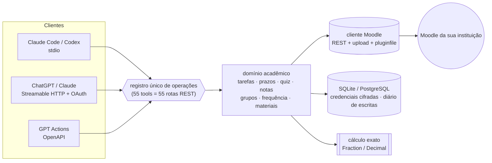

<p align="center"></p>

<p align="center">
  <a href="https://github.com/matheussilvano/moodle-mcp/actions/workflows/ci.yml"></a>
  
  
  
  <a href="LICENSE"></a>
  <a href="CONTRIBUTING.md"></a>
</p>

<p align="center"><b>Seu Moodle dentro da sua IA.</b> Prazos, trabalhos, notas, faltas, materiais e avisos — com os <i>seus</i> tokens e o <i>seu</i> modelo.<br>
<a href="README.en.md">English</a> · <a href="docs/tools.md">55 ferramentas</a> · <a href="docs/feature-matrix.md">o que está validado</a> · <a href="CONTRIBUTING.md">contribuir</a></p>

> Projeto **comunitário e independente**, sem vínculo oficial com a UFSC, o Moodle, a Anthropic ou a OpenAI. Primeiro alvo: Moodle Presencial da UFSC; a arquitetura aceita outras instituições.

<p align="center"><br><sub>Logo do Moodle® usada só para indicar a plataforma com a qual este projeto se integra.<br><b>Este projeto não é oficial</b>: não é feito, apoiado nem aprovado pela Moodle Pty Ltd.</sub></p>

---

## ✨ Em ação

```text
você ▸ Quais trabalhos tenho para entregar nos próximos 7 dias? Separe os já enviados.

claude ▸ (list_deadlines · janela: 2026-11-04 15:30 → 2026-11-11 15:30, America/Sao_Paulo)
  ✅ enviado     Lista 2 ........ Banco de Dados II ... 04/11 23:59
  ⏳ pendente    Trabalho T ..... Banco de Dados II ... 04/11 23:59  (corte 06/11)
  ⏳ pendente    Entrega parcial  Modelagem de Proc. .. 08/11 23:59
```
<sub>Exemplo ilustrativo com dados sintéticos.</sub>

| Você diz | O servidor faz |
| --- | --- |
| “Quais prazos na **próxima semana**?” | cruza tarefas + questionários + calendário; devolve a janela exata (semana civil ≠ 7 dias) |
| “Leia o enunciado, use os slides e **faça o trabalho**.” | `get_assignment` → `read_material` (PDF/DOCX/PPTX com páginas) → você gera o arquivo |
| “**Envie** minha atividade.” | upload → rascunho → envio → **lê de volta** e mostra a evidência |
| “Posso faltar na terça? Quantas aulas ainda posso perder?” | conta exata por horas-aula, chamadas pendentes, encontros críticos |
| “Quanto preciso tirar na P2 para passar?” | simulação determinística; nota não lançada ≠ zero |
| “Entre no grupo 3, se tiver vaga.” | Group choice com checagem de vagas e leitura de volta |
| “Avisos novos desde ontem?” | `changes_since` com snapshots |

## 🚀 Comece em 3 minutos

```bash
# 1) token: https://presencial.moodle.ufsc.br/user/managetoken.php  (serviço "Moodle mobile web service")
uvx --from git+https://github.com/matheussilvano/moodle-mcp moodle-academic-mcp configure --profile ufsc --service mobile
# 2) teste a conexão
uvx --from git+https://github.com/matheussilvano/moodle-mcp moodle-academic-mcp doctor
# 3) conecte ao seu cliente (vale em qualquer pasta)
claude mcp add --scope user --transport stdio moodle -- uvx --from git+https://github.com/matheussilvano/moodle-mcp moodle-academic-mcp serve
codex mcp add moodle -- uvx --from git+https://github.com/matheussilvano/moodle-mcp moodle-academic-mcp serve
```
Reinicie o cliente e pergunte: *“liste meus cursos atuais”*. Requer Python 3.11+ e [uv](https://docs.astral.sh/uv/). Ainda **não** está no PyPI. ChatGPT e GPTs personalizados precisam do [modo hospedado](docs/auth.md). Guia por cliente: [docs/clients.md](docs/clients.md).

## 🧭 Como funciona



Duas regras de ouro: **cada pessoa usa o próprio token** (nada de token compartilhado ou singleton) e **o texto de PDFs, fóruns e páginas é dado não confiável** — nunca autoriza ações.

## ✅ Estado da validação (sem maquiagem)

| Área | Testes automáticos (mock) | Moodle real (UFSC 4.1.5+) |
| --- | :---: | :---: |
| Cursos, tarefas, estado, calendário, lista de fóruns | ✅ | ✅ leitura |
| Entrega (upload → rascunho → envio), quiz, grupos, fórum (escrita) | ✅ | ⛔ **não testado** |
| Frequência (cálculo) / notas (simulação) | ✅ 100% puro | n/a |
| Attendance, VPL, Group choice (adaptadores) | ✅ | ⛔ não validado |
| Modo hospedado (HTTP, onboarding, PostgreSQL 16) | ✅ | n/a |
| OIDC com IdP real · ChatGPT · Codex | ⛔ | ⛔ |

Quer ajudar a mover um ⛔ para ✅? Veja o [sandbox](docs/sandbox.md) — é a contribuição mais valiosa.

## 🔒 Segurança e privacidade

- Tokens fora de logs, URLs, resultados e do modelo; `userprivateaccesskey` removido; cifrados no modo hospedado.
- Downloads só para o host Moodle do perfil; SSRF bloqueado; arquivos locais confinados a pastas permitidas.
- Escritas são ferramentas **separadas e anotadas**; você (ou o cliente) decide a política de confirmação — [exemplos](examples/).
- Nada de “Entrar com UFSC” nem senha institucional. Detalhes: [SECURITY.md](SECURITY.md) · [privacy](docs/privacy.md).

## 🤝 Contribua (é fácil)

```bash
git clone https://github.com/matheussilvano/moodle-mcp && cd moodle-mcp
make setup     # uv sync + hooks
make check     # lint + tipos + testes (≈10 s, sem credenciais, sem internet)
```
- 🌱 [Issues para começar](https://github.com/matheussilvano/moodle-mcp/labels/good%20first%20issue) · 🗺️ [Roadmap](docs/roadmap.md) · 🏫 [Adicionar sua universidade](docs/add-institution.md)
- Testes usam um **Moodle falso** (`tests/fake_moodle.py`) — nenhum dado real. Nunca marque algo como validado sem rodar num Moodle de verdade.
- Comece por [CONTRIBUTING.md](CONTRIBUTING.md); dúvidas em [Discussions](https://github.com/matheussilvano/moodle-mcp/discussions).

## 📚 Documentação

[Ferramentas](docs/tools.md) · [Arquitetura](docs/architecture.md) · [Tokens e VPN](docs/tokens.md) · [Clientes](docs/clients.md) · [Hospedagem e auth](docs/auth.md) · [Frequência e notas](docs/attendance-grades.md) · [Matriz de recursos](docs/feature-matrix.md) · [Fluxos](docs/workflows.md)

Licença [MIT](LICENSE). A licença cobre o código deste repositório, não a logo e o nome "Moodle", que são marcas registradas de [Moodle Pty Ltd](https://moodle.com) e aparecem aqui só para identificar a plataforma. Este projeto é independente e **não é oficial**.
