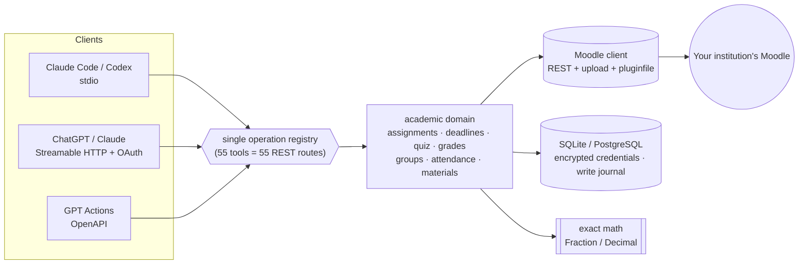

<p align="center"></p>

<h1 align="center">moodle-academic-mcp</h1>

<p align="center"><sub>The Moodle® logo is used only to show which platform this project connects to.<br><b>This project is unofficial</b>: it is not made, endorsed or approved by Moodle Pty Ltd.</sub></p>

<p align="center">
  <a href="https://github.com/matheussilvano/moodle-mcp/actions/workflows/ci.yml"></a>
  
  
  
  <a href="LICENSE"></a>
  <a href="CONTRIBUTING.md"></a>
</p>

<p align="center"><b>Your Moodle, in your AI.</b> Deadlines, assignments, grades, attendance, materials and announcements, with <i>your</i> tokens and <i>your</i> model.<br>
<a href="docs/tools.md">55 tools</a> · <a href="docs/feature-matrix.md">what is validated</a> · <a href="CONTRIBUTING.md">contributing</a></p>

> A **community, independent** project, not affiliated with UFSC, Moodle, Anthropic or OpenAI. The first target is UFSC's Moodle "Presencial"; the architecture supports other institutions ([guide](docs/add-institution.md)).

---

## ✨ In action

```text
you ▸ Which assignments are due in the next 7 days? Separate the ones already submitted.

claude ▸ (list_deadlines · window: 2026-11-04 15:30 → 2026-11-11 15:30, America/Sao_Paulo)
  ✅ submitted   Lista 2 ........ Banco de Dados II ... 11/04 23:59
  ⏳ pending     Trabalho T ..... Banco de Dados II ... 11/04 23:59  (cut-off 11/06)
  ⏳ pending     Entrega parcial  Modelagem de Proc. .. 11/08 23:59
```
<sub>Illustrative example with synthetic data.</sub>

| You say | The server does |
| --- | --- |
| "What is due **next week**?" | combines assignments + quizzes + calendar; returns the exact window (calendar week ≠ 7 days) |
| "Read the statement, use the slides and **do the assignment**." | `get_assignment` → `read_material` (PDF/DOCX/PPTX/ODF with page references) → you generate the file |
| "**Submit** my assignment." | upload → draft → submit → **reads it back** and shows the evidence |
| "Can I skip Tuesday? How many classes can I still miss?" | exact count by class hours, pending roll calls, critical meetings |
| "What do I need on the P2 to pass?" | deterministic simulation; a grade not yet posted ≠ zero |
| "Join group 3 if there is room." | group choice with a seat check and a read-back |
| "Any new announcements since yesterday?" | `changes_since` with snapshots |

## 🚀 Start in 3 minutes

```bash
# 1) token: https://presencial.moodle.ufsc.br/user/managetoken.php  (service "Moodle mobile web service")
uvx --from git+https://github.com/matheussilvano/moodle-mcp moodle-academic-mcp configure --profile ufsc --service mobile
# 2) test the connection
uvx --from git+https://github.com/matheussilvano/moodle-mcp moodle-academic-mcp doctor
# 3) connect it to your client (works in any folder)
claude mcp add --scope user --transport stdio moodle -- uvx --from git+https://github.com/matheussilvano/moodle-mcp moodle-academic-mcp serve
codex mcp add moodle -- uvx --from git+https://github.com/matheussilvano/moodle-mcp moodle-academic-mcp serve
```
Restart the client and ask: *"list my current courses"*. Requires Python 3.11+ and [uv](https://docs.astral.sh/uv/). **Not** on PyPI yet. ChatGPT and custom GPTs need the [hosted mode](docs/auth.md). Per-client guide: [docs/clients.md](docs/clients.md).

## 🧭 How it works



Two golden rules: **each person uses their own token** (no shared token, no singleton), and **text from PDFs, forums and pages is untrusted data**, so it never authorizes actions.

## ✅ Validation status (no makeup)

| Area | Automated tests (mock) | Real Moodle (UFSC 4.1.5+) |
| --- | :---: | :---: |
| Courses, assignments, status, calendar, forum list | ✅ | ✅ read |
| Delivery (upload → draft → submit), quiz, groups, forum (write) | ✅ | ⛔ **not tested** |
| Attendance (math) / grades (simulation) | ✅ 100% pure | n/a |
| Attendance, VPL, Group choice (adapters) | ✅ | ⛔ not validated |
| Hosted mode (HTTP, onboarding, PostgreSQL 16) | ✅ | n/a |
| OIDC with a real IdP · ChatGPT · Codex | ⛔ | ⛔ |

Want to help move a ⛔ to ✅? See the [sandbox](docs/sandbox.md); it is the most valuable contribution.

## 🔒 Security and privacy

- Tokens stay out of logs, URLs, results and the model; `userprivateaccesskey` is removed; credentials are encrypted in hosted mode.
- Downloads only from the profile's Moodle host; SSRF is blocked; local files are confined to allowed folders.
- Writes are **separate, annotated tools**; you (or your client) decide the confirmation policy: [examples](examples/).
- No "Sign in with UFSC" and no institutional password. Details: [SECURITY.md](SECURITY.md) · [privacy](docs/privacy.md).

## 🤝 Contribute (it is easy)

```bash
git clone https://github.com/matheussilvano/moodle-mcp && cd moodle-mcp
make setup     # uv sync + hooks
make check     # lint + types + tests (~10 s, no credentials, no network)
```
- 🌱 [Good first issues](https://github.com/matheussilvano/moodle-mcp/labels/good%20first%20issue) · 🗺️ [Roadmap](docs/roadmap.md) · 🏫 [Add your university](docs/add-institution.md)
- Tests use a **fake Moodle** (`tests/fake_moodle.py`), no real data. Never mark something as validated without running it on a real Moodle.
- Start with [CONTRIBUTING.md](CONTRIBUTING.md); questions go to [Discussions](https://github.com/matheussilvano/moodle-mcp/discussions).

## 📚 Documentation

[Tools](docs/tools.md) · [Architecture](docs/architecture.md) · [Tokens and VPN](docs/tokens.md) · [Clients](docs/clients.md) · [Hosting and auth](docs/auth.md) · [Attendance and grades](docs/attendance-grades.md) · [Feature matrix](docs/feature-matrix.md) · [Workflows](docs/workflows.md)

[MIT](LICENSE) license. It covers the code in this repository, not the logo and the name "Moodle", which are trademarks of [Moodle Pty Ltd](https://moodle.com) and appear here only to identify the platform. This project is independent and **unofficial**.
